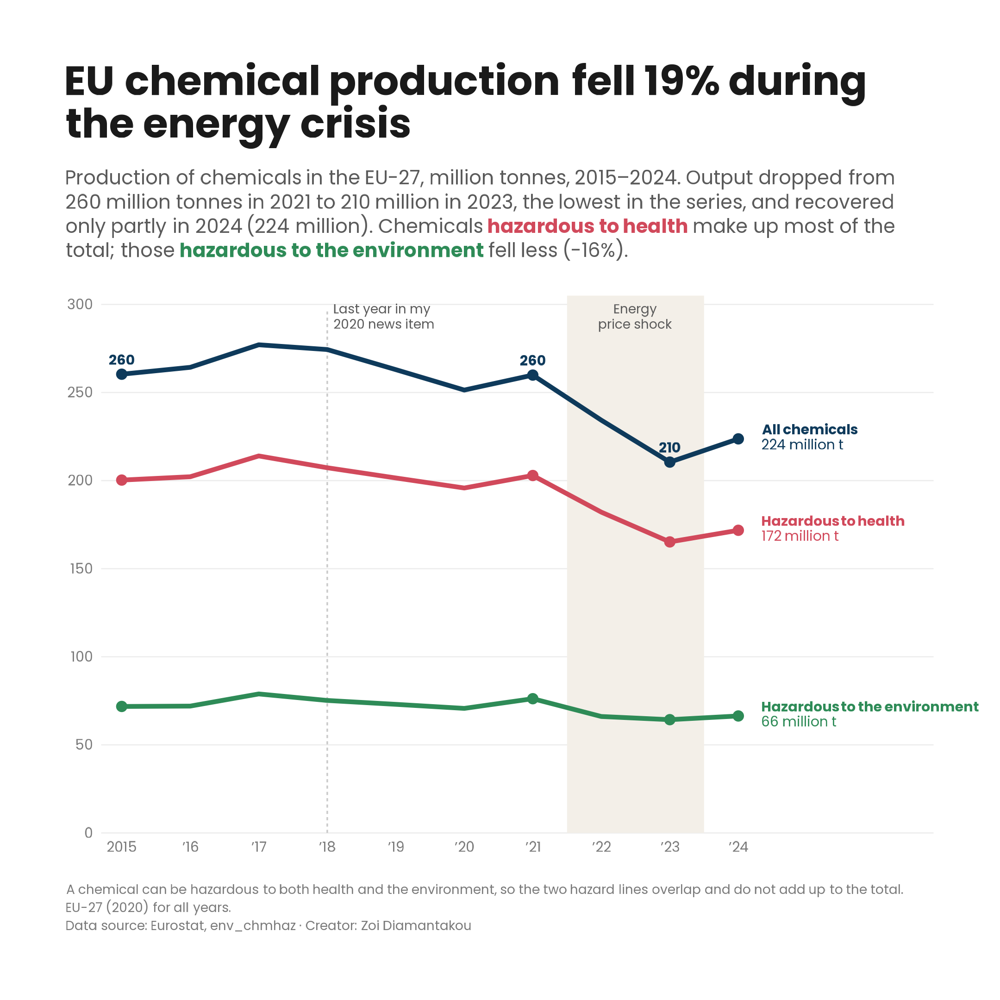
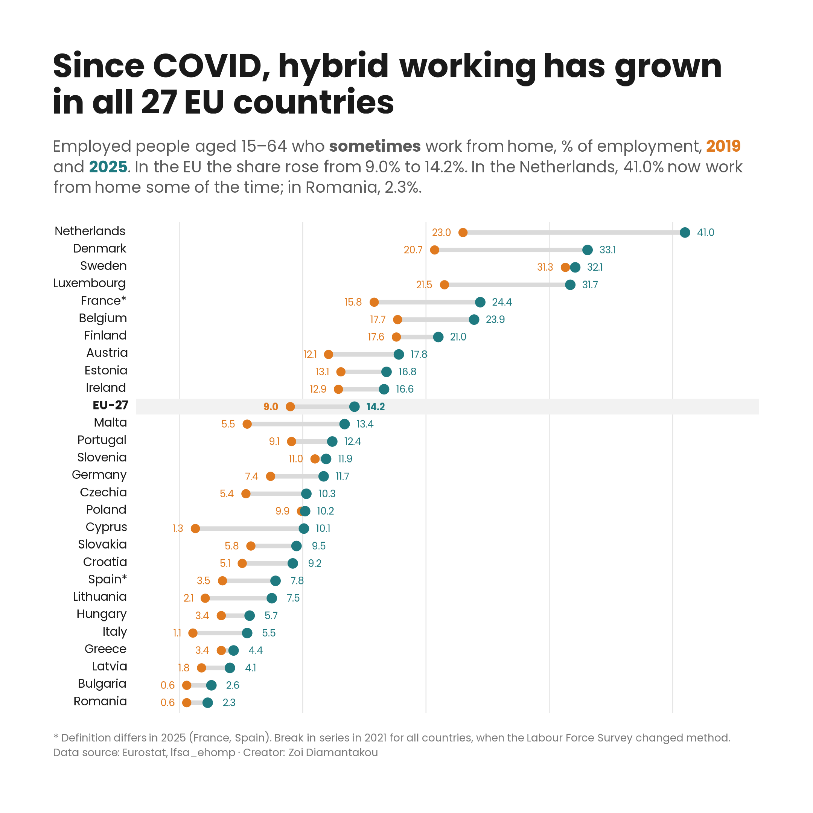

# Communicating European statistics

**125 news items · 9 statistical themes · 2020–2021 · six stories revisited with today's data**

## About the project

From 2020 to 2021 I was a statistical consultant for a company contracted by Eurostat to produce its "What's New" news items. I did the statistics, analysed the data and wrote 125 articles, including items on migration and asylum, disability, equality and living conditions. Eurostat set the topic and the dataset for each item. My work was the analysis, the quality checks, the writing, and the review rounds with Eurostat, and I coordinated with the design subcontractor who made the original visuals.

Many of those stories were written with data that ended in 2018–19, or in the middle of the pandemic. Today's data show what happened next. Here I revisit six of them with the latest Eurostat data, and this time I make the charts myself, in R.

Each case study follows the same structure: **what was published** → **what I explored further** → **working with the data** → **design choices** → **code**.

## Case studies

<table>
<tr>
<td width="33%" valign="top">

 <b><a href="case-studies/01-Chemicals/">In 2024 the EU produced 14% fewer chemicals than in 2015</a></b>
 
</td>
<td width="33%" valign="top">

 <b><a href="case-studies/02-Tourism/">After COVID, EU domestic tourism recovered first, but foreign grew more</a></b>
 
</td>
<td width="33%" valign="top">

 <b><a href="case-studies/03-Working-from-home/">Since COVID, hybrid working has grown in all 27 EU countries</a></b>
 
</td>
</tr>
<tr>
<td width="33%" valign="top">

 <b><a href="case-studies/04-early-school-leavers/">The EU is close to its 2030 school target, but young men are holding it back</a></b>
 
</td>
<td width="33%" valign="top">

 <b><a href="case-studies/05-deaths-from-influenze/">Flu deaths almost vanished in the EU in 2021, then came back</a></b>
 
</td>
<td width="33%" valign="top">

 <b><a href="case-studies/06-digital-skills/">In 2025, only 4 EU countries had reached the 2030 digital skills target</a></b>
 
</td>
</tr>
</table>

Click a chart or its title to open the case study. All six are also listed in [case-studies](case-studies/), and all 125 articles are in [publications.md](publications.md).

## What this repo shows

- **Working with official statistics:** finding the right dataset, and handling flags, breaks in series, revisions and EU aggregates that change over time (EU-28 to EU-27).
- **Data quality:** checking my own calculations against the figures Eurostat publishes, and noting what the data can't tell us.
- **Writing statistics for the public:** short, accurate text for readers who are not statisticians.
- **Reproducible analysis in R:** every chart is made from the downloaded data with one script, using tidyverse and ggplot2.

What I learned about working with Eurostat data is in [working-with-eurostat.md](working-with-eurostat.md).

## Repo layout

| Folder or file | What's inside |
|---|---|
| [`case-studies/`](case-studies/) | One folder per story: the write-up (`readme.md`), the R script, the data as downloaded from Eurostat, and the chart |
| [`publications.md`](publications.md) | All 125 news items, grouped by Eurostat theme, with links to the originals |
| [`working-with-eurostat.md`](working-with-eurostat.md) | Notes on Eurostat data: codes, aggregates, flags, breaks and more |

## Credits

Data: © European Union, Eurostat, reused under [Eurostat's copyright and reuse policy](https://ec.europa.eu/eurostat/about-us/policies/copyright). The analysis, text and charts in this repo are my own and are not official Eurostat products. The original news items are linked from each case study and from [publications.md](publications.md).

Created by Zoi Diamantakou · [Portfolio](https://zoidiama.github.io) · [GitHub](https://github.com/ZoiDiama)
