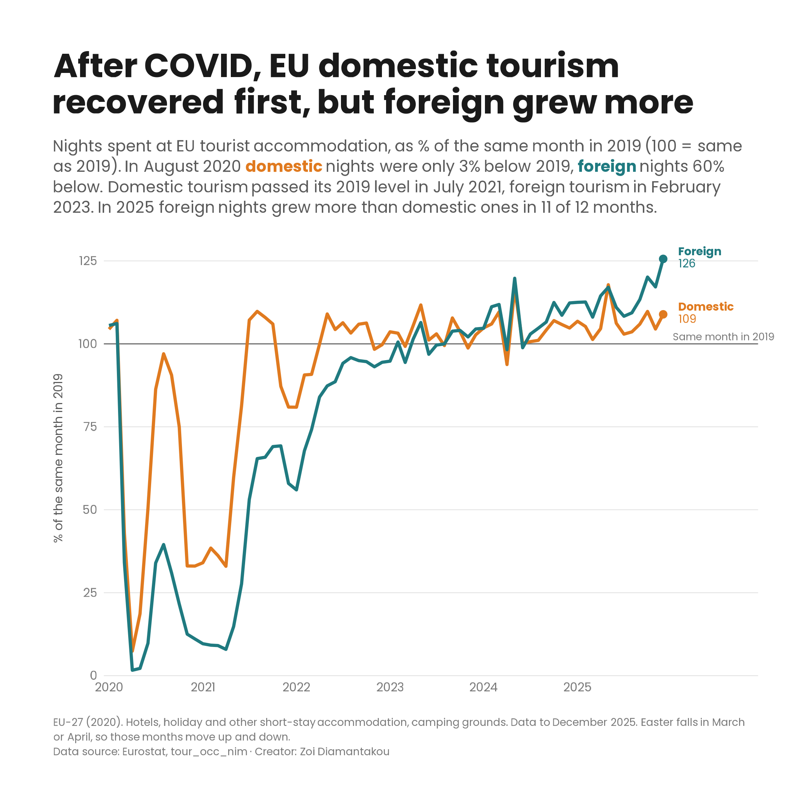

# 02 · Tourism nights in the EU after the pandemic

## What was published

**Eurostat news item, 16 July 2020** · [Tourism nights dropped sharply in March and April 2020](https://ec.europa.eu/eurostat/web/products-eurostat-news/-/DDN-20200716-1)

<!-- ✏️ Check against the original item and add its figures in your own words. -->
I analysed the data and wrote this item. It showed how nights spent at EU tourist accommodation collapsed in March and April 2020, the first two months of COVID-19 lockdowns, compared with the same months of 2019. The news format could only report the first months of the crisis.

## What I explored further

The original item stopped in April 2020. With monthly data up to December 2025, I asked how tourism recovered, and whether domestic and foreign tourists came back at the same pace.

- **Both collapsed in spring 2020.** In April 2020 nights fell by 93% for domestic tourists and by 98% for foreign tourists, compared with April 2019.
- **Domestic tourists came back first.** In August 2020 domestic nights were only 3% below August 2019, while foreign nights were still 60% below. Domestic tourism first passed its 2019 level in July 2021; foreign tourism only in February 2023. This fits the period: while travel across borders was restricted, people holidayed in their own country.
- **Foreign tourists have since grown more.** Both groups were above 2019 in every month of 2025, but foreign nights grew more than domestic nights in 11 of the 12 months. In December 2025 foreign nights were 26% above December 2019, domestic nights 9%.

| Year | Months above 2019: domestic | Months above 2019: foreign |
|---|---|---|
| 2021 | 4 | 0 |
| 2022 | 6 | 0 |
| 2023 | 9 | 7 |
| 2024 | 11 | 10 |
| 2025 | 12 | 12 |

**One more pattern.** In 2025 the growth was smallest in July and August, the peak season (foreign +8% and +9%, domestic +3% and +4%), and largest for foreign tourists from October to December (+17% to +26%). The data show *when* growth happened, not *why*.

## Working with the data

- **Dataset:** [`tour_occ_nim`](https://ec.europa.eu/eurostat/databrowser/view/tour_occ_nim/default/table), nights spent at tourist accommodation establishments, monthly data. EU-27 (2020); hotels, holiday and other short-stay accommodation, and camping grounds (NACE I551–I553); by country of residence of the guest (domestic, foreign).
- **Eurostat's own comparison with 2019.** Monthly nights swing with the seasons, so each month has to be compared with the same month of 2019, not with the month before. Eurostat publishes exactly this as a unit of the dataset ("percentage change compared to same month in 2019"), so I use it directly instead of calculating it myself.
- **Published up to December 2025.** For 2026 the comparison shows ":" (not available), so the analysis stops at December 2025.
- **Easter moves.** Easter falls in March or April depending on the year, so these two months jump around in a same-month comparison. In 2024, for example, April was below April 2019 because Easter fell in March.
- **Monthly, not annual.** The data are monthly percentage changes, so I compare months, not yearly totals: an average of monthly percentages is not the same as the change in the annual number of nights.
- **Data version:** downloaded from the Eurostat data browser, last updated 22 October 2026. Sheet 1 is Eurostat's table; the tab "Data" holds the same values as a clean table for the script. Recent months can be revised.

## Design choices

- **Each month as a % of the same month in 2019.** This removes the seasonal swings and puts the collapse, the recovery and today's level on one scale. The 100 line is marked "Same month in 2019".
- **Two lines, domestic and foreign.** The story is the gap between them: wide in 2020–2022, closed by 2023, reversed since 2024. The total is left out.
- **A line, not bars.** I also tried bars for each month of 2025, which showed the summer pattern more clearly, but lost the recovery. The line tells the whole story from the crash to today.
- **My own chart style, the same in every case study:** Poppins, a title that states the finding, and a subtitle with the numbers. Domestic is orange and foreign is teal, which colour-blind readers can still tell apart; the subtitle names the colours instead of a legend.
- **Direct labels** at the end of each line instead of a legend.

## Code

[`tourism.R`](tourism.R) · data in [`data/tour_occ_nim_vs2019.xlsx`](../../data/tour_occ_nim_vs2019.xlsx), tab "Data"
