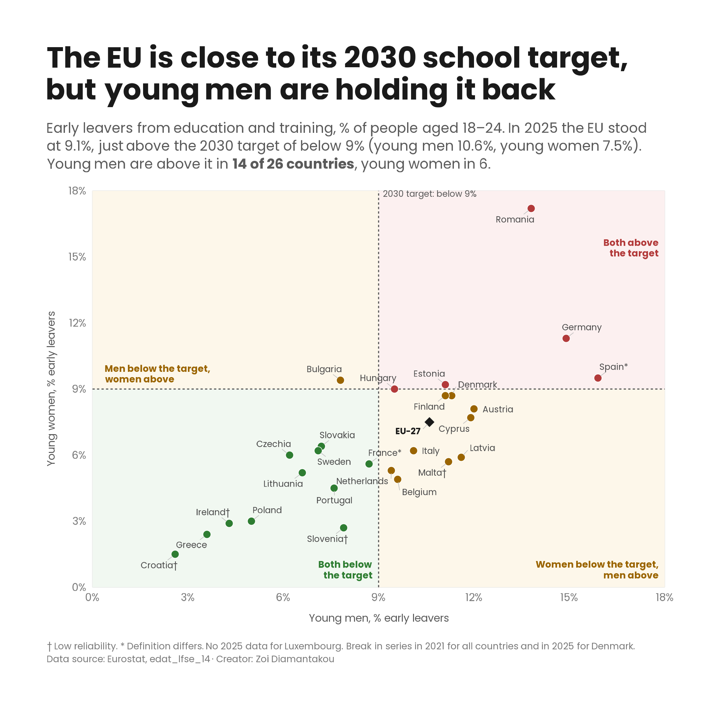

# 04 · Early school leavers and the EU 2030 target

## What was published

**Eurostat news item, 24 June 2021** · [Continued decline in early school leavers in the EU](https://ec.europa.eu/eurostat/web/products-eurostat-news/-/ddn-20210624-2)

I analysed the data and wrote this item on early leavers from education and training: people aged 18–24 who have at most lower secondary education and are not in further education or training. Their share in the EU had fallen steadily, from 13.8% in 2010 to 9.9% in 2020, and the EU had set a new goal of bringing it below 9% by 2030. In 2020, 18 Member States were already below that level. Rates ranged from 2.2% in Croatia to 16.7% in Malta. Young men left early more often than young women (11.8% against 8.0%), and this was the case in every Member State except Romania and Czechia.

## What I explored further

My item showed the EU moving towards the target. With data up to 2025, I asked how close the EU now is, and who is still above the line.

- **The EU is almost there.** In 2025, 9.1% of 18–24-year-olds in the EU were early leavers, just 0.1 points above the target. Seventeen countries are below 9%.
- **But mainly thanks to young women.** Young women in the EU have been below 9% every year since 2017 (7.5% in 2025). Young men have never been below it (10.6% in 2025).
- **Only 11 of 26 countries have met the target for both young men and young women.** In 9 countries young women are below 9% but young men are not: Austria, Belgium, Cyprus, Denmark, Finland, Italy, Latvia, Malta and the Netherlands. In 5 countries neither is: Germany, Spain, Romania, Estonia and Hungary (women exactly 9.0%). Bulgaria is the only country where young men have met the target and young women have not.
- **Young men leave early more often in 24 of 26 countries.** The exceptions are Romania and Bulgaria. The biggest gaps are in Spain (6.4 points), Latvia (5.7), Malta (5.5) and Slovenia (5.2).
- **Some big moves since my item.** Italy fell from 14.2% in 2020 to 8.2%, Bulgaria from 12.8% to 8.6% and Malta from 13.0% to 8.6%, so all three are now below 9% overall. Romania barely moved (15.6% to 15.5%) and is still the highest in the EU.

| EU-27, % of people aged 18–24 | 2010 | 2017 | 2020 | 2025 |
|---|---|---|---|---|
| Total | 13.8 | 10.5 | 10.0 | 9.1 |
| Young men | 15.8 | 12.1 | 11.9 | 10.6 |
| Young women | 11.6 | 8.9 | 8.1 | 7.5 |

So the EU total hides two different stories. Young women met the 2030 target years ago; whether the EU meets it depends on young men.

## Working with the data

- **Dataset:** [`edat_lfse_14`](https://ec.europa.eu/eurostat/databrowser/view/edat_lfse_14/default/table), early leavers from education and training by sex and labour status, from the EU Labour Force Survey. People aged 18–24, % of the population. The chart uses Sheet 6 (males) and Sheet 11 (females), labour status "Population"; the EU total comes from Sheet 1.
- **The figures have been revised since 2021.** Today's table does not match my news item everywhere. The EU 2020 value is now 10.0% (published 9.9%), young men 11.9% (11.8%) and young women 8.1% (8.0%). Some countries changed a lot: Malta 2020 is now 13.0% (published 16.7%) and Italy 14.2% (13.1%). Portugal moved from just below 9% to 9.1%, so 17 countries, not 18, now count as below the target in 2020. Revisions like these are normal with survey data, and are why every case study says which data version it uses.
- **Flags.**
  - Low reliability ("u", marked † on the chart): Croatia, and young women in Ireland, Malta and Slovenia. These are small numbers of people in the survey sample.
  - Definition differs ("d", marked *): Spain and France.
  - Break in series ("b"): all countries in 2021, when the Labour Force Survey changed its legal framework and method, and Denmark again in 2025.
- **Missing data.** Luxembourg has no 2025 value by sex (low reliability, not published), so the chart shows 26 countries.
- **A target that says "below".** The 2030 target is *below* 9%, so 9.0% has not met it. This decides one country: Hungary, where young women are at exactly 9.0%.
- **Data version:** downloaded from the Eurostat data browser, last updated 10 September 2026.

## Design choices

- **A scatter plot, young men against young women.** A line chart of the EU total would show the EU closing in on the target, but not that men and women are in different places. Plotting one sex on each axis shows both, for every country at once.
- **The target splits the chart into four areas,** coloured in pastel shades by what they mean: green where young men and young women are both below 9%, red where both are above, and amber where one is below and one above. Each dot takes the colour of its area, and each area is labelled on the chart, so there is no legend.
- **Dashed lines for the target,** at 9% on both axes.
- **The EU as a black diamond,** so it stands out from the countries.
- **No diagonal.** My first draft had a men = women line, which shows which sex leaves early more often. It answered a different question from the title, so I moved that finding to this write-up.
- **My own chart style, the same in every case study:** Poppins, a title that states the finding, and a subtitle with the key numbers.

## Code

[`early-school-leavers.R`](early-school-leavers.R) · data in [`data/edat_lfse_14.xlsx`](../../data/edat_lfse_14.xlsx), Sheets 1, 6 and 11
