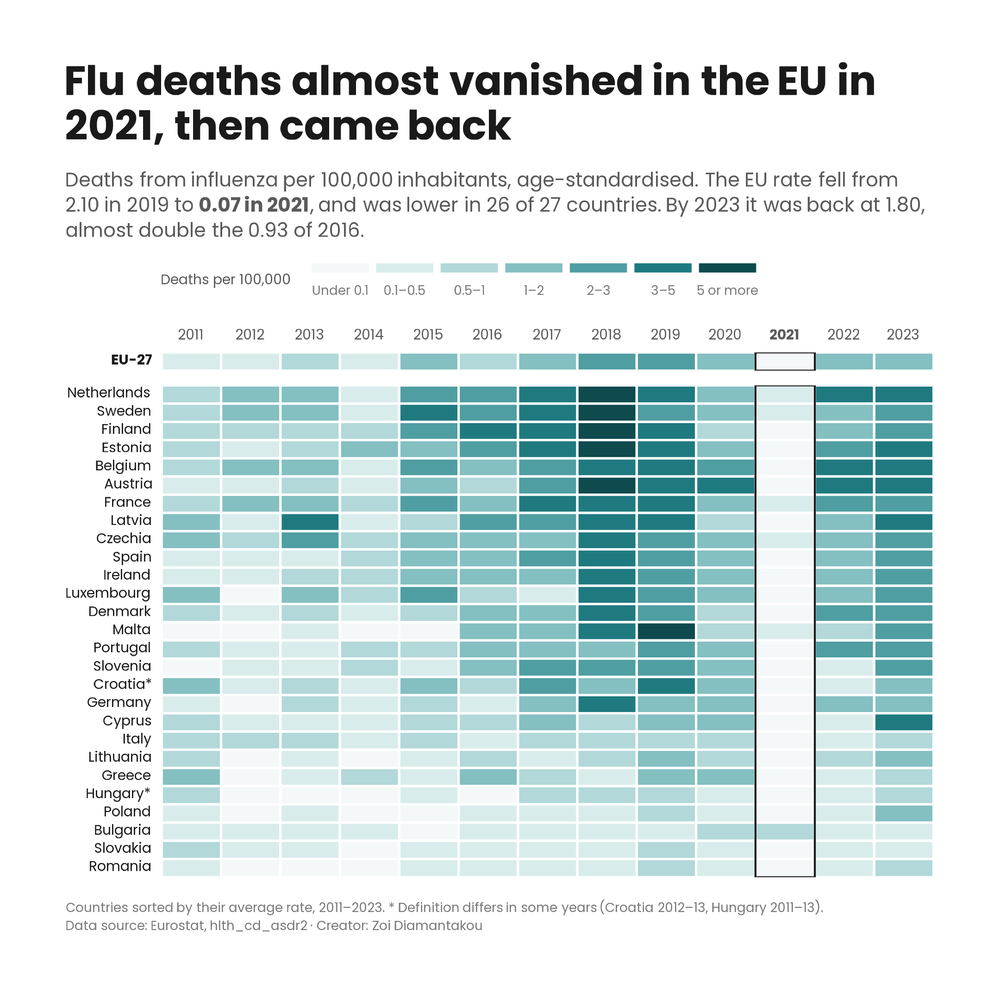

# 05 · Deaths from influenza in the EU before, during and after COVID

## What was published

**Eurostat news item, 7 April 2020** · [How many EU citizens die from influenza?](https://ec.europa.eu/eurostat/web/products-eurostat-news/-/DDN-20200407-1)

I analysed the data and wrote this item in the first weeks of the COVID-19 pandemic, when many people were comparing the new virus with seasonal flu. It looked at the latest data available at the time, for 2016. That year 4,186 people in the EU died from influenza, a standardised death rate of 9 per million inhabitants (0.93 per 100,000). Most of these deaths were among older people: the rate for people aged 65 or over was 34 per million in 2016, down from a peak of 58 in 2015. For people under 65 it was 3 per million, and lower still in the four years before.

## What I explored further

My item described flu deaths in one year, just before a pandemic changed how people lived. With data up to 2023, I asked what happened to flu deaths during and after COVID.

- **2016 was a mild year.** The EU rate nearly tripled by 2018 (2.69 per 100,000), the worst year since 2011 and the worst year in 17 of the 27 countries.
- **In 2021 flu deaths almost vanished.** The EU rate fell to 0.07, 97% below the 2018 peak. It was lower than in 2019 in 26 of 27 countries and below 0.1 in 21 of them. In 2021 social distancing, masks and travel restrictions were still widespread across Europe. The data show the drop, not its cause, but the timing is hard to miss.
- **Then flu came back.** The rate rose again in 26 countries in 2022–23 and reached 1.80 in 2023, almost double the 2016 level in my item. In 10 countries it was back at or above its 2019 level.
- **The swings are driven by older people.** The rate for people aged 65 or over moves far more than the rate for younger people:

| EU-27, deaths per 100,000, age-standardised | 2016 | 2018 | 2019 | 2021 | 2023 |
|---|---|---|---|---|---|
| All ages | 0.93 | 2.69 | 2.10 | 0.07 | 1.80 |
| 65 or over | 3.35 | 11.94 | 9.01 | 0.30 | 7.98 |
| Under 65 | 0.34 | 0.45 | 0.43 | 0.02 | 0.30 |

- **Countries differ a lot.** In 2023 the rate ranged from 4.79 in Austria and 4.25 in Cyprus to 0.24 in Slovakia. Romania, Hungary, Bulgaria, Slovakia and Poland have had low rates in almost every year since 2011.
- **One exception: Bulgaria.** It is the only country where the rate went up in 2020 and 2021 (0.73 and 0.69, against 0.20 in 2019), then fell back.

So the pandemic did not just add a new cause of death; for a year it almost removed an old one.

## Working with the data

- **Dataset:** [`hlth_cd_asdr2`](https://ec.europa.eu/eurostat/databrowser/view/hlth_cd_asdr2/default/table), causes of death, standardised death rate by NUTS 2 region of residence. I used the country level only. Cause: influenza (including swine flu), ICD-10 codes J09–J11. Rate per 100,000 inhabitants, both sexes, all ages. The download has 45 sheets (5 causes × 3 sexes × 3 age groups); the chart uses Sheet 5, and the script checks that it is the influenza sheet before using it.
- **Why standardised rates.** Flu deaths are concentrated among older people, so countries with older populations would have higher crude rates even if flu were equally deadly everywhere. Standardised rates adjust every country to the same standard age structure, which makes countries and years comparable.
- **Per 100,000 or per million.** My news item gave rates per million inhabitants (9 per million); the dataset gives them per 100,000 (0.93). Same number, different unit, so it is worth stating every time.
- **The same figures as in 2020.** Today's 2016 values match my news item (0.93 per 100,000 for all ages, 3.35 for people aged 65 or over, 0.34 for under 65), so the comparison starts from the published baseline.
- **Calendar years, not flu seasons.** Flu seasons run over the winter, from one calendar year into the next, but the data are annual. A single bad season can be split across two years, so the yearly figures smooth out some peaks.
- **What gets recorded as flu.** Standardisation removes differences in age, not differences in how deaths are certified. Flu is often not confirmed by a test, and a death may be recorded as pneumonia or another condition instead. This is likely part of the reason why rates are so low in some countries, such as Romania and Slovakia, so differences between countries should be read with care. COVID-19 deaths have their own ICD-10 codes and are not counted here.
- **Flags.** The definition differs ("d") for Croatia in 2012–13 and for Hungary in 2011–13 (marked * on the chart).
- **Data version:** downloaded from the Eurostat data browser, last updated 8 June 2026. Data run from 2011 to 2023.

## Design choices

- **A heatmap, one row per country and one column per year.** A line chart would show the EU rate going down and up, but the heatmap shows that the drop in 2021 happened in almost every country at once. The 2021 column is almost white from top to bottom, and the 2018 column is the darkest.
- **Colour bands instead of a smooth scale.** Most rates are below 1 and a few are above 5, so a smooth scale made most cells look the same. Seven fixed bands, from almost white (under 0.1) to dark teal (5 or more), show the differences.
- **The 2021 column outlined and its year in bold,** so the eye goes straight to the year in the title.
- **Countries sorted by their average rate over all years,** with the EU in its own row at the top.
- **One colour, teal,** because the chart shows one measure. A different colour for each country would add nothing.
- **My own chart style, the same in every case study:** Poppins, a title that states the finding, and a subtitle with the key numbers.

## Code

[`influenza.R`](influenza.R) · data in [`data/hlth_cd_asdr2.xlsx`](../../data/hlth_cd_asdr2.xlsx), Sheet 5
