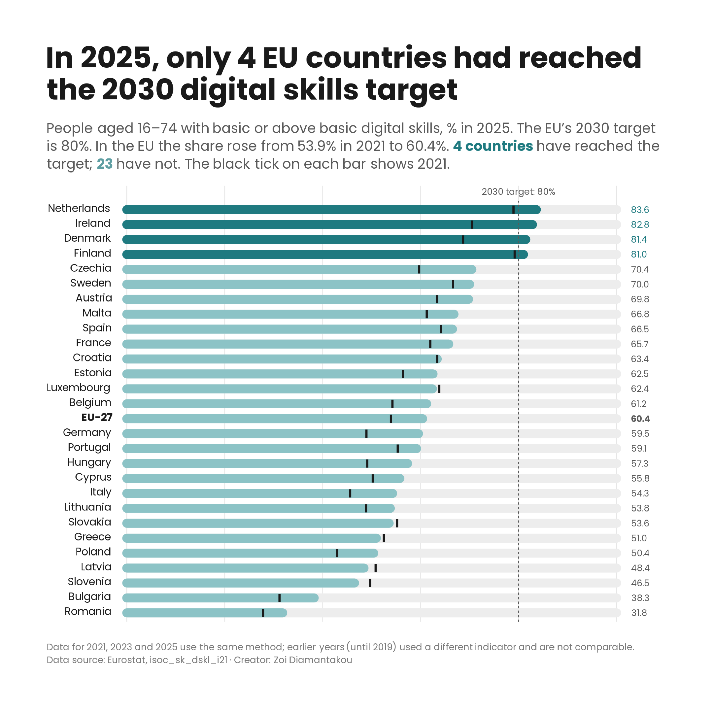

# 06 · Digital skills in the EU and the 2030 target

## What was published

**Eurostat news item, 14 May 2020** · [Digital skills of EU citizens living with children](https://ec.europa.eu/eurostat/web/products-eurostat-news/-/EDN-20200514-1)

I analysed the data and wrote this item in the first weeks of the pandemic, when schools had closed and many parents were suddenly helping their children learn online. It compared the digital skills of people aged 16–74 living with children with those of people living without children, using 2019 data. In the EU, 64% of people living with children had basic or above basic digital skills, against 53% of people living without children. The gap appeared in each country the item highlighted, for example Germany (80% against 67%), France (67% against 52%) and Finland (88% against 73%). Finland ranked first and Bulgaria last.

## What I explored further

My item was about one gap between two groups. Since then the EU has set itself a goal: by 2030, 80% of people aged 16–74 should have at least basic digital skills. With data up to 2025, I asked how far each country is from that goal.

- **Only 4 countries have reached the target.** In 2025 the Netherlands (83.6%), Ireland (82.8%), Denmark (81.5%) and Finland (81.0%) were above 80%. The EU as a whole was at 60.4%, up from 53.9% in 2021.
- **All four crossed the line after 2021.** In 2021 no country was at 80% yet; the Netherlands (78.9%) and Finland (79.2%) were close. Denmark (+12.8 points since 2021) and Ireland (+12.3) had the biggest rises in the EU. Czechia (+10.8) and Germany (+10.6) also rose strongly.
- **Five countries went backwards.** The share fell between 2021 and 2025 in Greece, Latvia, Luxembourg, Slovenia and Slovakia. On the chart, their 2021 tick sits beyond the end of the bar.
- **Romania and Bulgaria are still last,** at 31.8% and 38.3%, as Bulgaria was in my 2020 item.
- **Age matters more than anything else.** No age group in the EU has reached 80%, not even the youngest:

| EU, % with basic or above basic digital skills | 2021 | 2025 |
|---|---|---|
| 16–24 | 71.2 | 74.6 |
| 25–34 | 68.6 | 74.5 |
| 35–44 | 64.3 | 70.1 |
| 45–54 | 55.1 | 62.3 |
| 55–64 | 42.0 | 50.5 |
| 65–74 | 25.5 | 33.0 |
| All ages, 16–74 | 53.9 | 60.4 |

  Older people are catching up faster (+7.6 points for 65–74, +3.4 for 16–24), but from far behind.
- **The gap from my item is still there.** In 2023, the latest year with this breakdown, 62.3% of people living with children had at least basic digital skills, against 52.8% of people living without children, and the gap was there in all 27 countries. People living with children are younger on average, though, so much of this gap is an age gap rather than an effect of having children.

So the EU is moving towards its target, but slowly. If the pace of 2021–2025 continued (about 1.6 points a year), the EU would be at about 68% in 2030, not 80%. This is a simple straight-line calculation, not a forecast.

## Working with the data

- **Dataset:** [`isoc_sk_dskl_i21`](https://ec.europa.eu/eurostat/databrowser/view/isoc_sk_dskl_i21/default/table), individuals' level of digital skills (from 2021 onwards), from the EU survey on ICT usage in households and by individuals. Indicator: individuals with basic or above basic overall digital skills, % of individuals aged 16–74. The chart uses Sheet 23 of `isoc_sk_dskl_i21_household.xlsx` (all individuals); the age table uses `isoc_sk_dskl_i21_age.xlsx`.
- **A new indicator, not comparable with my item.** My 2020 item used the old indicator ([`isoc_sk_dskl_i`](https://ec.europa.eu/eurostat/databrowser/view/isoc_sk_dskl_i/default/table), until 2019). From 2021 Eurostat measures digital skills with a new, longer set of survey questions across five areas: information and data literacy, communication and collaboration, digital content creation, safety, and problem solving. A person has "basic or above basic" skills only if they reach at least the basic level in all five. The two series cannot be joined into one line, which is why the chart starts in 2021.
- **Every two years.** The new indicator is collected in odd years: 2021, 2023 and 2025.
- **Not every breakdown is published every year.** The split by household type (with and without children) is available for 2021 and 2023 but not yet for 2025, so the comparison with my item stops in 2023.
- **Two units in the same table.** The download gives each indicator as a % of all individuals and as a % of people who used the internet in the last three months. The EU target is set for all people aged 16–74, so I used the first. The script checks the sheet's labels before using it, because the download has 145 sheets.
- **Flags.** No EU country has a flag for 2025.
- **Data version:** downloaded from the Eurostat data browser, last updated 17 April 2026.

## Design choices

- **Progress bars, one per country.** The question is "how far is each country from 80%?", and a progress bar shows exactly that: a full track from 0 to 100%, filled up to the country's share, with the target marked on it. The idea comes from the [progress bar](https://datavizproject.com/data-type/progress-bar/) in the Data Viz Project.
- **Two shades of one colour:** dark teal for countries that have reached the target, light teal for those that have not, named in the subtitle instead of a legend.
- **A black tick for 2021** on each bar, so the chart shows progress as well as position. Where the tick is beyond the end of the bar, the country has gone backwards.
- **Values at the end of each bar and no axis labels;** light gridlines every 20 points stay as a guide. The EU in bold, in its sorted place.
- **Not the parents' gap.** I first planned to update my item's comparison of people with and without children. The data for 2025 is not split that way, and the gap is mostly about age, so I moved to the EU target. I also tried progress bars by age group for the EU; I kept the countries for the chart and put the age figures in the table above.
- **My own chart style, the same in every case study:** Poppins, a title that states the finding, and a subtitle with the key numbers.

## Code

[`digital-skills.R`](digital-skills.R) · data in [`data/isoc_sk_dskl_i21_household.xlsx`](../../data/isoc_sk_dskl_i21_household.xlsx), Sheet 23; age figures from [`data/isoc_sk_dskl_i21_age.xlsx`](../../data/isoc_sk_dskl_i21_age.xlsx)
